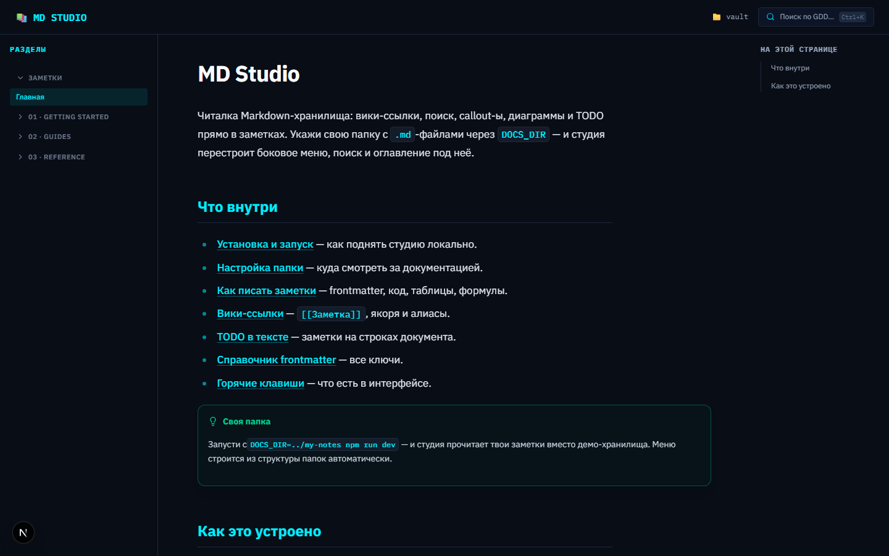
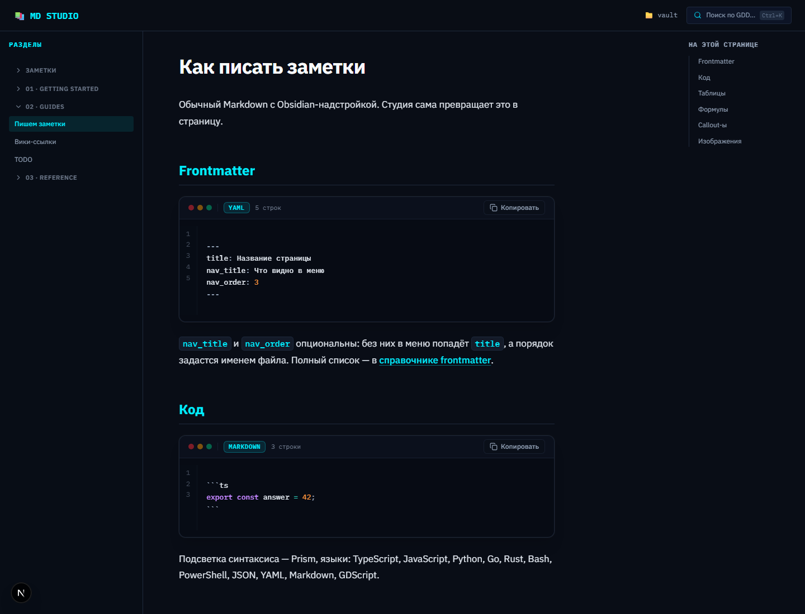

# MD Studio



Веб-студия для чтения своей документации в Markdown. Указываешь папку с `.md`-файлами —
получаешь сайт: боковое меню из структуры папок, поиск, вики-ссылки, callout-ы, диаграммы
и TODO прямо на строках текста.

Никакой базы и никакого редактора: заметки остаются обычными файлами, которые можно
держать в git.



## Что умеет

| Возможность | Как это выглядит |
| --- | --- |
| **Своя папка** | `DOCS_DIR=../my-notes npm run dev` — читается любое дерево `.md` |
| **Меню из папок** | папка верхнего уровня → раздел, вложенная → группа, файл → страница |
| **Вики-ссылки** | `[[Заметка]]`, `[[Заметка\|алиас]]`, `[[Заметка#Раздел]]`; битая ссылка видна серым «призраком» |
| **Callout-ы** | `> [!note]`, `> [!tip]`, `> [!warning]`, `> [!danger]`, `> [!info]` |
| **TODO на строке** | клик по номеру строки — заметка, привязанная к якорю строки |
| **Поиск** | MiniSearch по заголовкам и разделам, `Ctrl`/`Cmd` + `K` |
| **Код** | Prism: TypeScript, JavaScript, Python, Go, Rust, Bash, PowerShell, JSON, YAML, Markdown |
| **Формулы** | KaTeX, `$в строке$` и `$$отдельным блоком$$` |
| **Диаграммы** | блок ` ```mermaid ` рисуется как схема, с зумом и полноэкранным режимом |
| **Картинки** | отдаёт их один маршрут с проверкой пути на выход за пределы папки |
| **Статика** | все страницы пререндерятся при сборке, поиск живёт на клиенте |

## Быстрый старт

```bash
npm install
npm run dev          # http://localhost:3000
```

Своя папка с документацией:

```bash
DOCS_DIR=/home/user/notes npm run dev
```

PowerShell:

```powershell
$env:DOCS_DIR = "C:\Users\me\notes"
npm run dev
```

В шапке видно, какая папка подключена сейчас.

### Как должна выглядеть папка

```
my-notes/
  00_index.md          # индекс хранилища → /docs
  01_intro/            # папка → раздел меню «01 · Intro»
    01_welcome.md
  02_api/              # вложенная папка → группа внутри раздела
    01_endpoints.md
    reference.md
```

- `nav_title` и `nav_order` в frontmatter меняют подпись и порядок в меню.
- `assets/` и `.obsidian/` в меню не попадают.
- `00_index.md` в папке — её индекс по адресу `/docs/<папка>`.

## Команды

```bash
npm run dev         # дев-сервер
npm run build       # статическая генерация всех страниц
npm run start       # прод-сервер
npm run lint        # ESLint
npm run typecheck   # tsc --noEmit
npm test            # Vitest
npm run docs:stats  # сколько файлов, строк и слов в подключённой папке
```

## Как устроено

```
src/
  app/
    (docs)/docs/[[...slug]]/page.tsx   # страница документа, generateStaticParams
    api/vault/image/route.ts            # отдача картинок из папки
    api/vault/comments/route.ts         # CRUD TODO-заметок
  lib/vault/
    config.ts      # где лежит папка (DOCS_DIR)
    indexer.ts     # обход папки → карта файлов и страниц
    navigation.ts  # дерево меню из папок
    reader.ts      # чтение и разбор заметки
    mdx-compiler.ts# сборка MDX
    sanitize-mdx.ts# вики-ссылки, картинки, экранирование
    comments/      # TODO-заметки
    plugins/       # remark-плагины: callout-ы, номера строк
  components/
    docs/          # меню, поиск, оглавление, галерея, код
    mdx/           # компоненты для MDX
vault/             # демо-хранилище (подменяется на вашу папку)
data/              # файл TODO-заметок (в репозитории не хранится)
```

Пара решений, которые стоит знать:

- **Одно чтение на запрос.** Файл документа читается один раз: `readDoc` обёрнут в
  `cache` из React, поэтому метаданные и страница не читают его дважды.
- **Путь проверяется до диска.** `id` заметки проверяется регулярным выражением
  *до* обращения к файлу, а `path.relative` — после: `..` не проходит ни туда, ни обратно.
- **Битые ссылки видны.** Несуществующая вики-ссылка рендерится «призраком», а не
  обычной ссылкой — сразу видно, что в папке рассинхронизировалось.
- **Якоря совпадают.** Слаг заголовка для оглавления и для `rehype-slug` считает одна
  функция, поэтому переход по якорю попадает точно в заголовок.

## Требования

Node.js 20+. Всё остальное ставится через `npm install`.

## Лицензия

MIT — см. [LICENSE](LICENSE).

Автор и владельцы репозитория: **IvanGlazyrin** (<glazrus97@gmail.com>), **glazrus97@gmail.com**.
