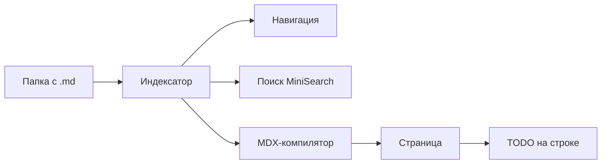
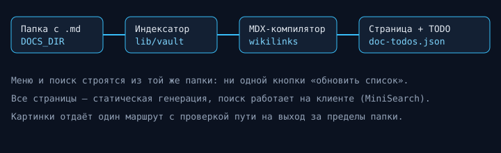

Читалка Markdown-хранилища: вики-ссылки, поиск, callout-ы, диаграммы и TODO
прямо в заметках. Укажи свою папку с `.md`-файлами через `DOCS_DIR` — и студия
перестроит боковое меню, поиск и оглавление под неё.

## Что внутри

- [[01_getting_started/01_install|Установка и запуск]] — как поднять студию локально.
- [[01_getting_started/02_configuration|Настройка папки]] — куда смотреть за документацией.
- [[02_guides/01_writing|Как писать заметки]] — frontmatter, код, таблицы, формулы.
- [[02_guides/02_wikilinks|Вики-ссылки]] — `[[Заметка]]`, якоря и алиасы.
- [[02_guides/03_todos|TODO в тексте]] — заметки на строках документа.
- [[03_reference/01_frontmatter|Справочник frontmatter]] — все ключи.
- [[03_reference/02_shortcuts|Горячие клавиши]] — что есть в интерфейсе.

> [!tip] Своя папка
> Запусти с `DOCS_DIR=../my-notes npm run dev` — и студия прочитает твои заметки
> вместо демо-хранилища. Меню строится из структуры папок автоматически.

## Как это устроено

